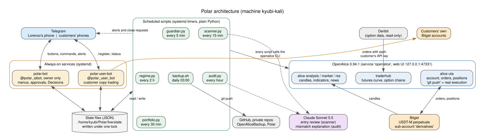
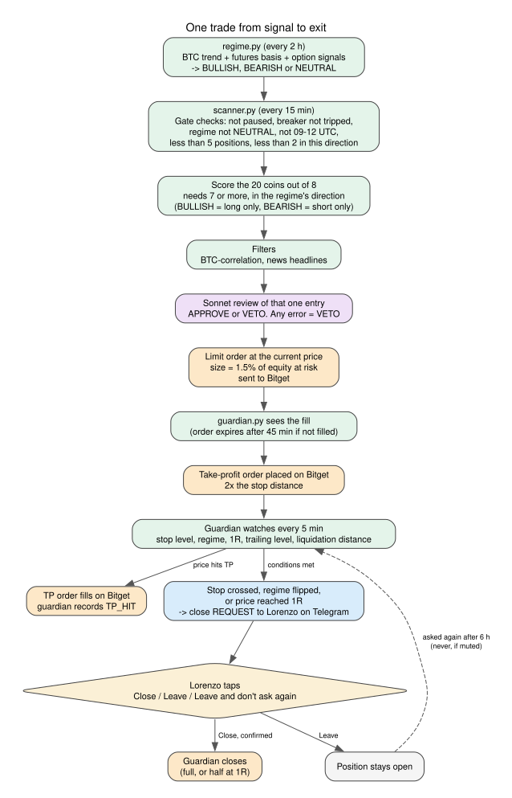

# 02 Architecture



([PNG version](diagrams/architecture.png))

## Layers, top to bottom

**Telegram.** The only interface for people. Lorenzo talks to `@polar_aibot`. Customers talk to
`@polar_user_bot`. The scheduled scripts also send alerts straight to Lorenzo's chat.

**Always-on services.** `polar-bot` and `polar-user-bot` run all the time and wait for messages.
They are systemd user services and restart themselves if they crash.

**State files.** A folder of JSON files (`/home/kyubi/polar/state`). This is how the pieces pass
information to each other: the scanner writes a pending order, the guardian reads it, the bot reads
what the guardian wrote. Nothing talks to anything else directly. Details in
[07 State files](07-state-files.md).

**Scheduled scripts.** Six jobs started by systemd timers (the seventh, the weekly update check,
is only a notification). Each run starts, does its work, and exits. See
[05 Scheduled jobs](05-scheduled-jobs.md).

**OpenAlice.** A background service (`openalice`, version 0.94.1) that the scripts call through its
command line, `openalice exec ...`. It has three tools Polar uses:

| OpenAlice tool | Used for |
|---|---|
| `alice analysis` / `alice market` / `alice rss` | Candles and indicators (RSI, EMA, ATR, z-score, correlation, relative volume) from Bitget, and news headlines. |
| `traderhub` | The Bitcoin futures price curve and Deribit option chains. |
| `alice-uta` | Account info, positions, orders. It stages orders; `git push` sends them to Bitget. |

**Bitget and Deribit.** Orders and positions go through Bitget. Deribit is only a data source for the
options signals in the regime check. Nothing is traded there.

## How one trade moves through it



([PNG version](diagrams/trade-lifecycle.png))

The same flow in words, with the file each step uses:

| Step | Script | Reads | Writes |
|---|---|---|---|
| Decide market direction | `regime.py` | BTC candles, futures curve, Deribit options | `regime.json` |
| Pick and place an entry | `scanner.py` | `regime.json`, `pause.json`, `circuit-breaker.json`, open and pending files, candles, news | `pending-orders.json`, `trade-signals.jsonl` |
| Notice the fill, place the take-profit | `guardian.py` | `pending-orders.json`, Bitget | `open-positions.json`, `trade-signals.jsonl` |
| Watch the position | `guardian.py` | `open-positions.json`, Bitget, `regime.json` | `close-requests.json`, `open-positions.json` |
| Ask Lorenzo | `guardian.py` | | Telegram message with buttons |
| Record his answer | `polar-bot` | | `close-approvals.json` or a mark in `close-requests.json` |
| Close if approved | `guardian.py` | `close-approvals.json` | Bitget close order, then `trade-signals.jsonl` |
| Copy for customers | `polar-user-bot` | `trade-signals.jsonl` | customers' Bitget accounts, `customers/copies.json` |

## Design choices worth knowing

- **Scripts, not agents.** Entry rules, stop checks and health checks are fixed rules. They run as
  ordinary Python, which is cheap, repeatable and testable. A model is called only where judgement
  adds something (the entry review) or where text is needed (the audit explanation).
- **One writer for every close.** Only the guardian sends a close command, and only after an
  approval. This makes the "never close without permission" rule checkable by reading one function.
- **Files with a lock instead of a database.** The data is small and the writers are few. All
  writers take the same lock file (`.state.lock`) and change only the keys they own, so a slow
  script can't overwrite a tap that arrived while it was running.
- **Stops are not exchange orders.** The stop level is watched by the guardian every 5 minutes and
  turns into a request to Lorenzo. Only the take-profit is a real order on Bitget. This follows
  from rule 1 above and has a cost, explained in [10 Known limits](10-known-limits.md).
- **The broker is the source of truth.** The guardian and scanner compare their files with what
  Bitget reports. If a position seems to vanish, the guardian reads Bitget a second time after a
  4 second wait before treating it as closed.

## Redrawing the diagrams

Graphviz is installed on the machine. From this folder:

```bash
cd diagrams
for f in architecture trade-lifecycle close-approval; do
  dot -Tsvg $f.dot -o $f.svg
  dot -Tpng -Gdpi=110 $f.dot -o $f.png
done
```
