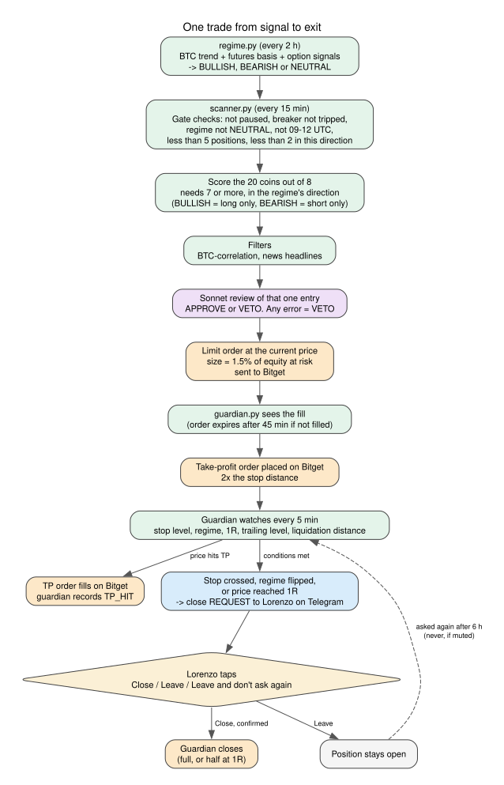

# 03 Strategy

The strategy is short-term trend following on 20 coins, gated by a market-wide direction filter and
managed with fixed risk. All thresholds below are taken from the code (`regime.py`, `scanner.py`,
`guardian.py`) as of 2026-10-27.

## In one paragraph

Bitcoin sets the mood. If Bitcoin looks bullish, Polar may only buy; if bearish, it may only sell
short; if unclear, it does nothing. Inside the allowed direction it looks for coins that are already
moving that way on the 4-hour chart but are not stretched on the 15-minute and 1-hour charts, with
above-average volume. It enters with a limit order, risks 1.5% of the account on a stop that is
sized to the coin's recent volatility, and aims for twice that distance as profit.

## Step 1: the market regime (`regime.py`, every 2 hours)

Five signals each give +1, 0 or -1. Their sum is the regime score, from -5 to +5.

| Signal | +1 (bullish) | -1 (bearish) | 0 |
|---|---|---|---|
| BTC vs its 20-period average, 4-hour chart | price above | price below | |
| BTC vs its 20-period average, daily chart | price above | price below | |
| Futures basis (annualised premium of futures over spot) | above +5% | below -5% | in between, or data missing |
| Put/call ratio (open interest, next 3 option expiries, Deribit) | below 0.7 | above 1.3 | in between, or data missing |
| 25-delta skew (put volatility minus call volatility, nearest expiry) | below -3 points | above +3 points | in between, or data missing |

- Score **+3 or more**: BULLISH. Only longs are allowed.
- Score **-3 or less**: BEARISH. Only shorts are allowed.
- Anything else: NEUTRAL. No new entries.

The result goes to `regime.json`. A change of regime sends a Telegram message. Regime also feeds
into the guardian: a position held against a new regime triggers a close request (see step 5).

## Step 2: the gates (`scanner.py`, every 15 minutes)

The scanner stops before looking at any coin if any of these is true:

- trading is paused (`pause.json`) or the circuit breaker has tripped (`circuit-breaker.json`)
- either of those files, or the open and pending order files, cannot be read
- the regime is NEUTRAL
- the time is between 09:00 and 12:59 UTC (a low-activity window chosen earlier)
- 5 positions are already open or pending, counting what Bitget itself reports
- the allowed direction already has 2 positions
- free margin is under $15

## Step 3: the score (out of 8)

The scanner looks at the 20 coins that are not already held:
BTC, ETH, SOL, BNB, XRP, DOGE, ADA, AVAX, LINK, SUI, NEAR, ARB, APT, INJ, OP, HYPE, AAVE, WIF, TIA, SEI.

The coin's direction is set by price against its 4-hour 20-period average (above: long, below:
short). Then it earns points:

| Check | Points (long) | Points (short) |
|---|---|---|
| RSI(14) on the 15-minute chart | 2 if between 50 and 70 | 2 if between 30 and 50 |
| RSI(14) on the 1-hour chart | 2 if between 48 and 68 | 2 if between 32 and 52 |
| 8-bar z-score of price, 15-minute chart (how far price is from its recent mean) | 2 if between -0.5 and 1.5 | 2 if between -1.5 and 0.5 |
| 20-bar z-score, 1-hour chart | 1 if above 0 | 1 if below 0 |
| Relative volume, 15-minute chart (volume against its 20-bar average) | 1 if 1.4 or more | 1 if 1.4 or more |

A coin needs **7 or more** in the direction the regime allows. Because three checks are worth 2
points each, a coin that fails any one of those three can't qualify. Only the two 1-point checks can
be missed, and only one of them.

In plain terms: the trend is up (or down), momentum agrees on two timeframes, price is not already
stretched far from its recent average, and volume is above normal.

## Step 4: filters, review and the order

For each coin that scores 7 or more, best score first:

1. **BTC correlation.** If the coin has moved with Bitcoin at more than 0.9 correlation, and a
   same-direction position that is just as correlated is already open (or was picked earlier in this
   run), the coin is dropped. Two such positions would be one Bitcoin bet.
2. **News.** If a headline from the last 2 hours mentions the coin together with a warning word
   (exploit, hack, SEC, lawsuit, delisting, investigation, breach, freeze, pause, compromised), the
   coin is skipped and the skip is logged. If the news feed is down, this check passes (see
   [10](10-known-limits.md)).
3. **Size.**
   - Stop distance = 1.5 x ATR(14) of the 15-minute chart, as a share of price, limited to between
     0.5% and 1.5%.
   - Quantity = 1.5% of equity divided by the stop distance in dollars, and not more than 80% of the
     free margin at 10x. The quantity is rounded to the exchange's lot size.
   - If rounding leaves the risk above 2% of equity, the trade is skipped.
4. **Review.** Claude Sonnet 5.5 sees the setup, the open positions and recent headlines and answers
   APPROVE or VETO. A veto, an error or a timeout means no order, and a Telegram message says why.
5. **Order.** A limit order at the current price is staged and pushed to Bitget. At most 3 entries
   are placed in one run, and never more than the caps allow.

If the limit order has not filled after 45 minutes, the guardian cancels it.

## Step 5: managing the position (`guardian.py`, every 5 minutes)

When the entry fills (even partly), the guardian:

- cancels any unfilled remainder of the entry order,
- places a **take-profit** limit order for the filled quantity at **2 x the stop distance** from the
  real average fill price, and
- records the position with its **stop level** at 1 x the stop distance on the losing side.

Every run after that it checks, in this order:

| Condition | What happens |
|---|---|
| Price has crossed the stop level | A **close request** goes to Lorenzo (reason `stop_breach`). |
| The regime is now the opposite of the position (BEARISH for a long, BULLISH for a short) | A close request (reason `regime_shift`). |
| Price has moved 1R in the trade's favour (one stop distance) | The stop level moves to the entry price (breakeven). Once, with a message. |
| After breakeven | The stop level trails price at 1 x ATR(14) of the 15-minute chart, moving only in the trade's favour. A message is sent when it has moved by at least a quarter of an ATR. |
| 1R reached and no partial taken yet | A request to close **half** the position (reason `partial_1R`). If half is below the exchange's minimum lot, no request is made. |
| Price is within 30% of the liquidation price | An information message, at most once per 2 hours. Nothing is closed. |
| The position is gone from Bitget | It is recorded as `TP_HIT` (the take-profit order filled or the exit was within 0.2% of the target) or `CLOSED_EXTERNAL`, with the real fill price. Leftover orders are cancelled. |

The stop level, breakeven and trailing are **levels the guardian watches**, not orders on the
exchange. Their only effect is to create a close request. What Lorenzo answers decides what happens
next ([04 Risk and safety](04-risk-and-safety.md)).

## What the strategy assumes

- Short-term momentum in the direction of the larger trend continues long enough to reach 2R before
  1R is lost. With a 2:1 target, the strategy breaks even at about a 33% win rate before fees and
  funding, and needs more than that to be worth running.
- Bitcoin's regime is a fair proxy for the whole altcoin market. This is weaker for coins that
  move on their own news.
- The 20-coin list is liquid enough that a limit order at the current price usually fills within
  45 minutes.

## What the record shows so far

On 2026-10-27 the trade log held 11 closed trades. Results are price movement from entry to exit in
percent. They are not account returns: leverage and the 1.5% sizing are not applied.

| | |
|---|---|
| Wins / losses | 8 / 3 |
| Average win / average loss | +1.65% / -2.48% |
| Sum of all trades | +5.7% |

- The average loss is larger than the 1.5% maximum stop distance the scanner uses. Why has not
  been analysed yet.
- Of the 9 trades that carry a regime label, all 3 losses were stop-loss exits taken in a NEUTRAL
  regime, before the score rule existed. The 5 trades taken in a BULLISH or BEARISH regime, with a
  score of 7, were all winners.
- Those are very small samples (2 to 5 trades per row on the bot's Metrics screen). They show
  nothing about the strategy's real edge. Treat them as a log, not as evidence.

## Things the strategy deliberately does not do

- No exchange-side stop orders (the close needs Lorenzo's tap).
- No averaging down, no adding to a position, no reversing.
- No options or other instruments. Options data is only an input to the regime score.
- No trading in a NEUTRAL regime, during the 09:00-12:59 UTC window, while paused, or after the
  circuit breaker has tripped.
