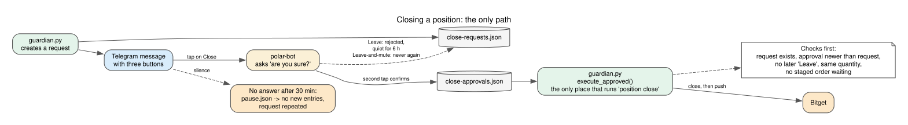

# 04 Risk and safety

## Limits on exposure

| Limit | Value | Enforced by |
|---|---|---|
| Risk per trade | 1.5% of equity (order skipped if rounding pushes it above 2%) | scanner |
| Open + pending positions | 5 | scanner, counted from files and from Bitget |
| Positions in one direction | 2 | scanner |
| New entries per scanner run | 3 | scanner |
| Margin used per order | at most 80% of free margin; no entry if free margin is under $15 | scanner |
| Leverage | 10x (set on the account, assumed by the scanner's sizing) | Bitget account setting |
| Drawdown circuit breaker | new entries stop when equity is more than 10% below its 24-hour peak | portfolio |

There is no cap on the total value of all positions together. Each position is sized by its own
risk, so a run of small stop distances can add up to a large total. Lorenzo has been offered a cap
(total value up to 1.5x equity) and has not decided yet.

## Circuit breaker

`portfolio.py` records equity every 30 minutes and keeps 7 days of history. If equity is more than
10% below the highest value of the last 24 hours, it writes `circuit-breaker.json` with
`halted: true`, and the scanner stops opening trades. It resets by itself once drawdown is back
under 10% and at least 12 hours have passed. It never touches open positions.

## Pause

`pause.json` also stops new entries. The guardian sets it when a close request has gone unanswered
for 30 minutes. Lorenzo clears it with `/resume`, and answering every waiting request in Decisions
clears a pause that was caused by unanswered requests. A pause never touches open positions.

## Closing a position

([PNG version](diagrams/close-approval.png))

### The rule

No script closes, partly closes or reduces a position by itself. The close command appears in one
place in the code, `execute_approved()` in `guardian.py`. It runs only for a coin that has an entry
in `close-approvals.json`, and that file is written only by the Telegram bot when Lorenzo taps.

### What starts a request

| Reason | When |
|---|---|
| `stop_breach` | Price crossed the stop level (this includes the breakeven and trailing levels). |
| `regime_shift` | The regime turned against the position. |
| `partial_1R` | Price reached 1R. Asks to close half. |

The request goes to Lorenzo as a Telegram message with three buttons, and is stored in
`close-requests.json`. The message says whether Close means a full close or a partial one, and shows
entry, price, profit or loss and the stop level.

### The three answers

| Button | Effect |
|---|---|
| Close | Asks "are you sure?". Only the second tap writes the approval. |
| Leave | The position stays. The request is marked rejected and Polar stays quiet about that position for 6 hours. If the reason still holds then, it asks again. |
| Leave and don't ask me again | Asks "are you sure?". After the second tap the position is muted: no more close requests until it is gone. Liquidation-distance messages still come. |

The same three buttons are on every request message, and all open requests are listed under
**Decisions** in the bot menu or with `/decisions`. A position that was already answered stays
listed, so the answer can be changed.

### What the guardian checks before it closes

Even with an approval on file, the guardian refuses and tells Lorenzo (the approval is dropped) if:

- the request it belongs to no longer exists,
- the approval is older than the request,
- a "Leave" came after the approval,
- the quantity in the approval differs from the request, or
- the broker already has staged, unsent orders. Closing on top of them could do something else.

After the close is sent, the approval is used up. It cannot trigger a second close. If a partial
close succeeds, the guardian cancels the old take-profit and places a new one for what is left. The
closing price recorded in the trade log is the real fill price from Bitget.

### If nobody answers

Silence never counts as yes. After 30 minutes without an answer the guardian pauses new entries and
repeats the request every 30 minutes. The pause message lists which coins are waiting. Nothing is
closed.

## What the guardian does not protect against

- **A gap before an answer.** Because stops are not orders on Bitget, a fast move can go past the
  stop level while a request waits for Lorenzo. The guardian looks every 5 minutes, and a human has
  to read and tap. This is the price of the "never close without permission" rule.
- **Liquidation.** At 10x, a loss of roughly 10% of the position value, less maintenance margin,
  liquidates it. The guardian warns when price is within 30% of the liquidation price but does not act.
- **Exchange or network outages.** If Bitget's API fails, the scripts skip the run. A position
  never looks closed because of a single failed read; the guardian reads twice first.

## Safeguards in the scanner

- Unreadable pause, breaker or position files make it stop for that run.
- The broker's own position list is counted in the caps, not only Polar's files.
- The Sonnet review fails closed. Any error is a veto.
- It places entry orders only. It never places a stop or a take-profit and never closes.

## Safeguards for customers' copied trades

See [06 Telegram bots](06-telegram-bots.md#customer-bot).

## Checks that run on their own

The hourly audit compares Polar's files with Bitget and reports mismatches to Telegram. It checks:

- a Bitget position that Polar does not know about,
- a position in the files that is not on Bitget,
- a position with no resting take-profit order,
- an order with no position and no matching entry (a reduce-side order with no position could
  open a new one),
- a position whose value is above 2.5x equity.

It reads only. It never places, cancels or closes anything.
